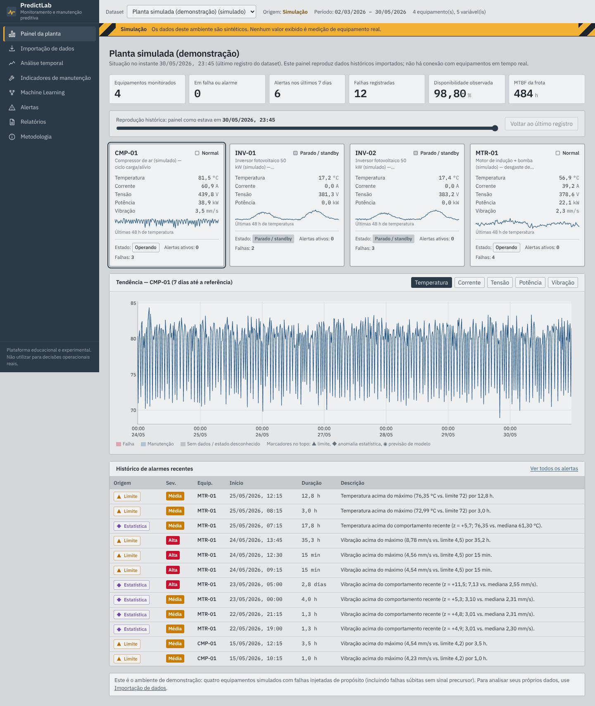

# PredictLab

[](https://github.com/Victor-alrib/predictlab/actions/workflows/ci.yml)

Plataforma web de manutenção preditiva para equipamentos industriais: importa históricos de sensores em CSV, calcula indicadores de manutenção (MTBF, MTTR, disponibilidade), detecta anomalias e treina modelos de Machine Learning que tentam antecipar falhas, avaliados com divisão temporal e comparados a uma linha de base.



> **Todos os números e imagens deste repositório vêm de dados SINTÉTICOS**, gerados pelo próprio PredictLab no modo demonstração. Nenhum valor é medição de equipamento real.

---

## Problema

Em manutenção industrial, muitas falhas dão sinais antes de acontecer: um rolamento vibra mais, um inversor esquenta porque o ventilador está degradando, um compressor passa a puxar mais corrente. Esses sinais costumam estar nos dados que o CLP e o SCADA já registram, mas raramente são analisados de forma sistemática.

O PredictLab cobre esse fluxo de ponta a ponta: importar o histórico, entender o comportamento do equipamento, calcular indicadores clássicos de manutenção e testar com rigor se um modelo consegue antecipar falhas — e mostrar quando ele não consegue.

## Abordagem

### Dados

- **Importação de CSV com mapeamento de variáveis.** Cada arquivo pode ter colunas diferentes. O sistema sugere qual coluna é data/hora, equipamento, estado operacional e cada variável (temperatura, corrente, tensão, potência, vibração ou personalizada), e o usuário confirma. Separador (`,` `;` tab), vírgula decimal, codificação e formato de data são detectados automaticamente.
- **Origem declarada obrigatória.** Na importação o usuário declara se os dados são medição real, dataset público ou simulação. Simulação recebe uma faixa de aviso fixa na interface e marca d'água nos relatórios.
- **Modo demonstração.** Uma planta simulada com 4 equipamentos (2 inversores fotovoltaicos, 1 motor com bomba, 1 compressor), 90 dias com amostragem de 15 min (34.560 linhas). São 12 falhas injetadas: 9 com sinal precursor (temperatura ou vibração subindo antes) e 3 súbitas, sem precursor, colocadas de propósito para mostrar o que nenhum modelo baseado nesses sensores consegue prever. Também há 5 lacunas simulando perda de comunicação e 1 manutenção preventiva.

### Técnicas e por que foram escolhidas

| Etapa | Técnica | Por quê |
|---|---|---|
| Rótulo de falha | `y = 1` se uma falha começa nas próximas H horas (padrão 24 h); amostras já em falha são excluídas | O objetivo é antecipar a falha, não reconhecê-la depois que aconteceu |
| Atributos | Médias, desvios, mín./máx. em janelas de 1 h, 6 h e 24 h e desvio em relação à linha de base robusta de 7 dias — **só janelas para trás** | Evita vazamento de informação do futuro; há um teste automatizado que garante isso |
| Classificação | Random Forest e XGBoost, com pesos para a classe rara | Bons em dados tabulares e fáceis de interpretar pela importância dos atributos |
| Linha de base | Classificador aleatório estratificado; modelo ingênuo sazonal na previsão | Mostra o piso: um modelo que não supera isso não aprendeu nada útil |
| Validação | Divisão temporal treino/teste (sem embaralhar) e validação cruzada `TimeSeriesSplit` | Em série temporal, divisão aleatória coloca amostras quase idênticas no treino e no teste |
| Avaliação | Precisão, recall, F1, PR-AUC e **avaliação por evento**: falhas antecipadas, antecedência e alarmes falsos por 30 dias | É o que a operação percebe; PR-AUC é mais informativa que ROC-AUC com classes desbalanceadas |
| Anomalias | Isolation Forest e z-score robusto (mediana/MAD) por hora do dia | Funcionam sem rótulos de falha; o z-score robusto não é distorcido pelos próprios outliers |
| Previsão temporal | Holt-Winters e ARIMA com termos de Fourier, avaliados num holdout final | Modelos clássicos e leves para séries com ciclo diário |
| Indicadores O&M | MTBF, MTTR, disponibilidade intrínseca e observada, calculados só com dados suficientes (padrão: ≥ 2 falhas e ≥ 7 dias) | Evita exibir números pouco confiáveis; lacunas de dados não contam como operação |
| Alertas | Três origens separadas: limite configurado ▲, anomalia estatística ◆, previsão de modelo ◉ | Uma estimativa probabilística não deve ser lida como alarme determinístico |

A interface tem 7 módulos: painel da planta (com reprodução histórica), importação, análise temporal (tendência, sazonalidade com STL, comparação entre períodos), indicadores de manutenção, Machine Learning, alertas e relatórios em HTML.

## Resultados

Medidos rodando o código final sobre o **dataset de demonstração (sintético)**. Detalhes completos em [`resultados/`](resultados/).

**Previsão de falha nas próximas 24 h** — período de teste = últimos 30 % do tempo:

| Equipamentos | Modelo | Precisão | Recall | F1 | PR-AUC | Falhas antecipadas | Alarmes falsos / 30 dias |
|---|---|---|---|---|---|---|---|
| Só o motor (MTR-01) | Linha de base aleatória | 0,04 | 0,04 | 0,04 | 0,05 | 2 de 2 | 85,6 |
| Só o motor (MTR-01) | Random Forest | 0,99 | 1,00 | 1,00 | 1,00 | 2 de 2 | 1,1 |
| Só o motor (MTR-01) | XGBoost | 0,99 | 0,98 | 0,99 | 1,00 | 2 de 2 | 1,1 |
| Os 4 equipamentos | Linha de base aleatória | 0,06 | 0,04 | 0,05 | 0,04 | 5 de 5 | 57,8 |
| Os 4 equipamentos | Random Forest | 0,99 | 0,39 | 0,56 | 0,61 | 3 de 5 | 0,3 |
| Os 4 equipamentos | XGBoost | 0,89 | 0,50 | 0,64 | 0,55 | 4 de 5 | 0,6 |
| Os 4 equipamentos | Isolation Forest (não supervisionado) | 0,08 | 0,16 | 0,11 | 0,08 | 1 de 5 | 12,2 |

Como ler essa tabela:

- No motor sozinho os modelos parecem quase perfeitos, mas ali a degradação foi **injetada de forma limpa** (vibração crescendo exponencialmente) e o teste tem só 2 falhas. Isso não é desempenho esperado em campo.
- Com os 4 equipamentos o problema fica mais realista: F1 de treino ≈ 1,0 contra 0,56–0,64 no teste, e a validação cruzada temporal deu F1 0,29 ± 0,41 (Random Forest) e 0,30 ± 0,41 (XGBoost). A plataforma emite automaticamente o aviso de **sobreajuste**.
- A linha de base "antecipa" todas as falhas porque dispara alarmes aleatórios o tempo todo (58 a 86 por mês). A avaliação por evento só faz sentido olhando junto os alarmes falsos.

**Previsão temporal** (holdout das últimas 168 h):

| Série | Ingênuo sazonal (MAE) | Holt-Winters (MAE) | ARIMA + Fourier (MAE) |
|---|---|---|---|
| Potência do inversor INV-01 (kW) | 4,32 | **2,31** (−47 %) | 2,80 (−35 %) |
| Temperatura do motor MTR-01 (°C) | 5,21 | 5,68 (+9 %, pior) | **4,73** (−9 %) |

**Indicadores de manutenção da frota simulada:** 12 falhas, MTBF 483,8 h, MTTR 8,0 h, disponibilidade intrínseca 98,37 %.

**Qualidade do código:** 35 testes automatizados no backend passando (serviços e API); frontend sem erros de tipo no TypeScript.

## Como rodar

Pré-requisitos: **Python 3.11+** e **Node.js 20+**.

**1. Backend (API)** — num terminal, a partir desta pasta:

```bash
cd backend
python -m venv .venv
# Windows (PowerShell):   .venv\Scripts\Activate.ps1
# Linux/macOS:            source .venv/bin/activate
pip install -r requirements-dev.txt
uvicorn app.main:app --reload --port 8000
```

**2. Frontend (interface)** — em outro terminal:

```bash
cd frontend
npm install
npm run dev
```

Abra **http://localhost:5173**. Sem nenhum dataset importado, o modo demonstração já aparece carregado. A documentação interativa da API fica em **http://localhost:8000/docs**.

**3. Testes**

```bash
cd backend && python -m pytest
cd frontend && npm run typecheck
```

Para testar a importação, use os CSVs de [`examples/`](examples/) (também sintéticos), cada um com uma convenção diferente de colunas.

### Variáveis de ambiente

O projeto **não usa chaves de API, senhas nem tokens**. Há só configurações opcionais, todas lidas de variáveis de ambiente:

| Variável | Onde | Para que serve |
|---|---|---|
| `PREDICTLAB_CORS` | backend | Origens permitidas no CORS (padrão: `http://localhost:5173`) |
| `PREDICTLAB_NO_PERSIST` | backend | `1` desativa a gravação de datasets importados em disco |
| `VITE_API_URL` | frontend | Endereço da API para o proxy de desenvolvimento (padrão: `http://127.0.0.1:8000`) |
| `VITE_API_BASE` | frontend | Prefixo da API se ela estiver em outro domínio |

Se um dia o projeto precisar de uma credencial (por exemplo, para um banco de dados), ela deve ir num arquivo `.env` — que já está no `.gitignore` — e nunca no código.

## Limitações e próximos passos

**Limitações**

- Avaliado só com dados sintéticos; os padrões de degradação foram injetados de forma limpa, o que favorece os modelos.
- Poucas falhas no período de teste (2 a 5): todas as métricas têm incerteza alta e não há intervalos de confiança formais.
- O limiar de alerta do classificador é fixo, sem otimização por custo de falha × custo de parada.
- Execuções de modelos ficam só na memória e somem ao reiniciar a API; datasets importados são salvos em disco local.
- O frontend tem verificação de tipos, mas ainda não tem testes automatizados de interface.
- Os dados vêm de arquivos históricos; não há conexão em tempo real com CLP ou SCADA.

**Próximos passos**

- [ ] Rodar com um dataset público (AI4I 2020, NASA C-MAPSS ou *Solar Power Generation Data*) e registrar os resultados
- [ ] Persistência em SQLite/PostgreSQL com consultas SQL
- [ ] Autoencoder em PyTorch como detector de anomalia e LSTM para vida útil remanescente (RUL)
- [ ] Ingestão simulada via Modbus TCP (`pymodbus`)
- [ ] Versionamento de modelos com MLflow e Dockerfile

## Stack

**Backend:** Python, FastAPI, Pandas, NumPy, SciPy, scikit-learn, XGBoost, statsmodels, Plotly, pytest
**Frontend:** React, TypeScript, Tailwind CSS, Vite, Plotly.js, React Router
**Técnicas:** classificação desbalanceada, detecção de anomalias, séries temporais (STL, Holt-Winters, ARIMA), validação temporal, indicadores de confiabilidade (MTBF, MTTR, disponibilidade)

Documentação técnica: [arquitetura](docs/ARQUITETURA.md) · [metodologia](docs/METODOLOGIA.md) · [API](docs/API.md)

## Autoria

Desenvolvido por **Victor** (Engenharia de Controle e Automação — IFSP), com auxílio de IA (Claude) na escrita do código e da documentação.

## Licença

[MIT](LICENSE). Projeto educacional e experimental; não substitui análise de engenharia de confiabilidade.
